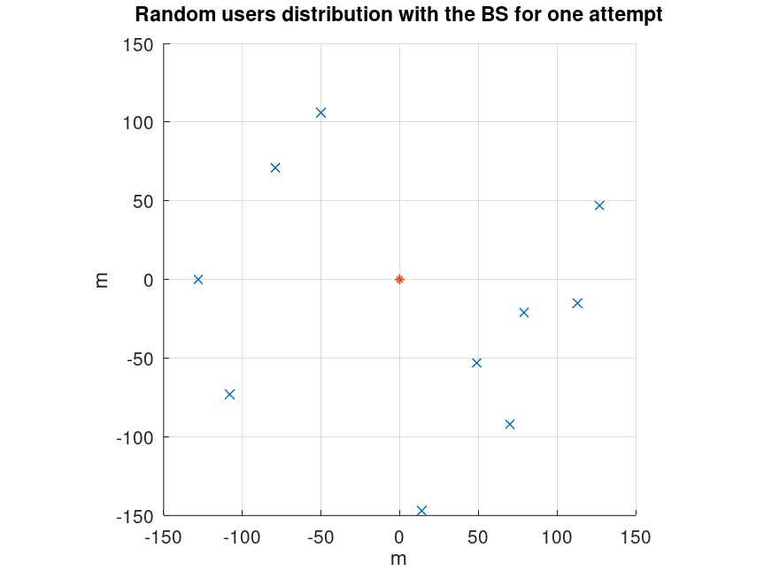
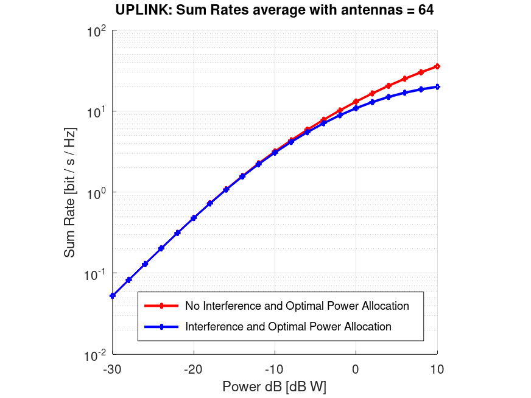
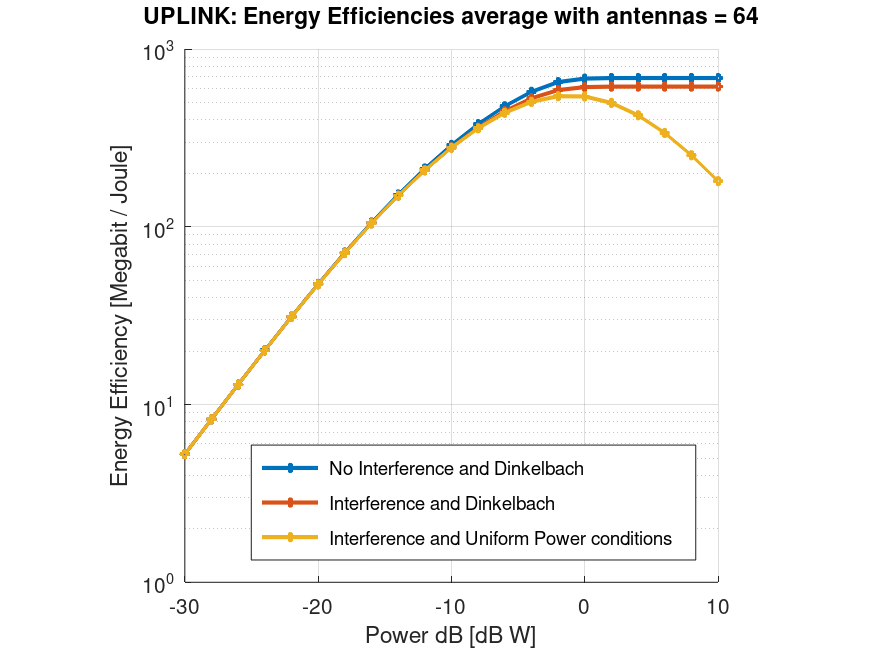
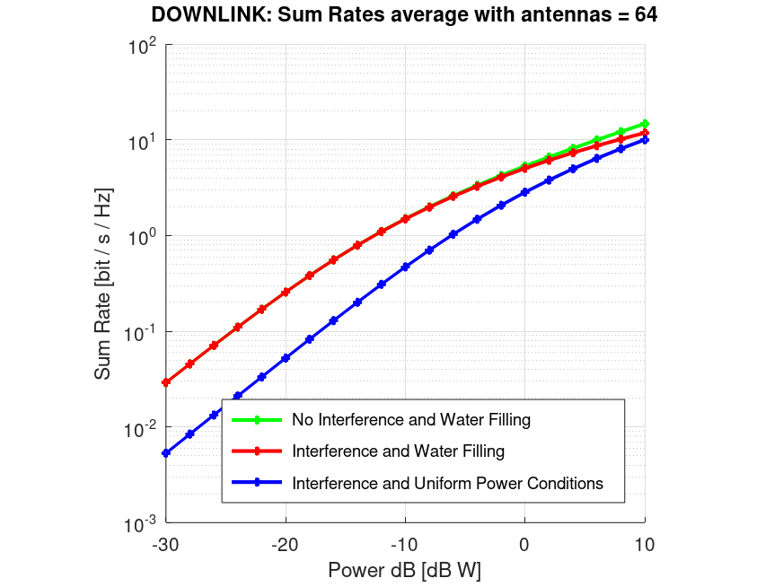
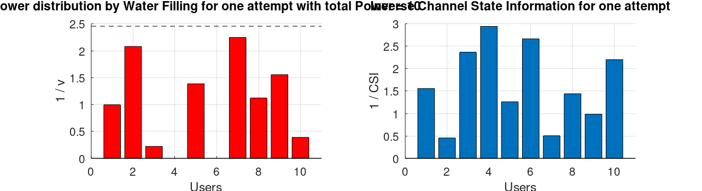
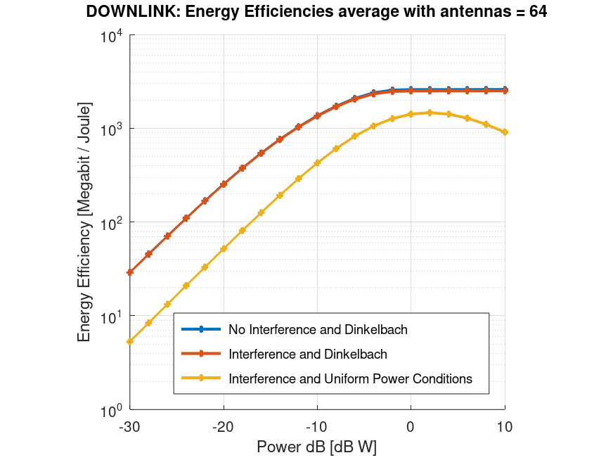

# 5G power optimization

Energy-efficient power allocation for multi-user massive MIMO (uplink and downlink), using Dinkelbach's algorithm for fractional programming and water-filling for sum-rate maximisation, in MATLAB.

**Bachelor's thesis project:** University of Cassino and Southern Lazio, 2020–21.



## System model

$K$ single-antenna users are dropped uniformly at random (positions rounded to 1 m) in an $l \times l$ square cell with the $N$-antenna base station (BS) at the centre. User $k$ at distance $d_k$ from the BS has large-scale gain and channel

$$
\beta_k = \frac{2\,PL_0}{1 + (d_k/d_0)^{\eta}}, \qquad
\mathbf h_k = \sqrt{\beta_k}\,\mathbf g_k, \quad \mathbf g_k \sim \mathcal{CN}(\mathbf 0, \mathbf I_N),
$$

and the noise power is $\sigma^2 = N_0 B F$. Results are averaged over $N_p$ independent drops (user positions and fading).

| Symbol | Code | Value |
|---|---|---|
| $K$ | `K` | 10 users |
| $N$ | `N` | 64 BS antennas |
| $N_p$ | `Np` | 1000 Monte Carlo drops |
| $l$ | `l` | 300 m |
| $PL_0$ | `PLo` | −84 dB |
| $d_0$ | `d0` | 35 m |
| $\eta$ | `eta` | 3.5 |
| $N_0$ | `No` | −140 dBm/Hz |
| $B$ | `B` | 1 GHz |
| $F$ | `F` | 1 (noise figure, linear) |
| $\mu_k$ | `Performance` | 1 (inverse amplifier efficiency) |
| $P_c$ | `P_c` | 1 W per user (uplink), 1 W total (downlink) |
| $P_{\max}$ | `P_max` | −30 to 10 dBW in 2 dB steps |

**Uplink:** the BS uses maximum-ratio combining, $\mathbf c_k = \mathbf h_k$. **Downlink:** the BS uses maximum-ratio transmission, $\mathbf q_k = \mathbf h_k / \lVert \mathbf h_k \rVert$. The effective channel gain $\gamma_k$ (`ChannelState` in `SumCapacityCalc.m`) is

$$
\gamma_k^{\mathrm{UL}} = \frac{|\mathbf h_k^H \mathbf h_k|^2}{\sigma^2 \lVert \mathbf h_k \rVert^2 + \sum_{j \ne k} p_j |\mathbf h_k^H \mathbf h_j|^2},
\qquad
\gamma_k^{\mathrm{DL}} = \frac{|\mathbf h_k^H \mathbf q_k|^2}{\sigma^2 + \sum_{j \ne k} p_j |\mathbf h_k^H \mathbf q_j|^2},
$$

where the interference sum is dropped in the "no interference" case. The sum rate is

$$
R(\mathbf p) = \sum_{k=1}^{K} B \log_2\left(1 + p_k \gamma_k\right).
$$

The optimisers below always work on the noise-limited $\gamma_k$ (no interference). The "with interference" curves take the same powers and re-evaluate $R$ with the interference terms included.

## Problems

### Sum-rate maximisation

**Uplink:** each user has its own power budget,

$$
\max_{\mathbf p}\ R(\mathbf p) \quad \text{s.t.} \quad 0 \le p_k \le P_{\max},\ k = 1, \dots, K.
$$

Without interference $R$ is increasing in every $p_k$, so the optimum is $p_k = P_{\max}$ for all users.

**Downlink:** the BS has a total power budget,

$$
\max_{\mathbf p}\ R(\mathbf p) \quad \text{s.t.} \quad p_k \ge 0,\ \sum_{k=1}^{K} p_k \le P_{\max}.
$$

The solution is water-filling (`WaterFilling.m`), with the water level $1/\nu$ found by bisection so that the budget is met within $10^{-5}$ W:

$$
p_k^\ast = \left[\frac{1}{\nu} - \frac{1}{\gamma_k}\right]^+, \qquad \sum_{k=1}^{K} p_k^\ast = P_{\max}.
$$

The baseline is uniform allocation, $p_k = P_{\max}/K$.

### Energy-efficiency maximisation

$$
\max_{\mathbf p}\ \frac{R(\mathbf p)}{\sum_k \mu_k p_k + P_c}
$$

with the uplink constraints $0 \le p_k \le P_{\max}$ (and $P_c = \sum_k P_{c,k}$) or the downlink constraints $p_k \ge 0,\ \sum_k p_k \le P_{\max}$. The baseline is the maximum-power (uplink) or uniform (downlink) allocation.

### Dinkelbach's algorithm

The fractional problem is solved through the auxiliary function

$$
F(\lambda) = \max_{\mathbf p}\left\{ R(\mathbf p) - \lambda \left( \sum_k \mu_k p_k + P_c \right) \right\},
$$

whose root $F(\lambda^\ast) = 0$ is the optimal energy efficiency. `Dinkelbach.m` iterates

1. $\mathbf p_n = \arg\max_{\mathbf p} \left\{ R(\mathbf p) - \lambda_n \left( \sum_k \mu_k p_k + P_c \right) \right\}$
2. $\lambda_{n+1} = \dfrac{R(\mathbf p_n)}{\sum_k \mu_k p_{k,n} + P_c}$

starting from the baseline efficiency (uplink, first power value; later values warm-start from the previous optimum) or the water-filling efficiency (downlink). The uplink stops when $F(\lambda_n) < \epsilon = 10^{-3}$, the downlink when $\lambda_{n+1} - \lambda_n < 10^{-10}$.

The inner step is solved in closed form. **Uplink:**

$$
p_k^\ast = \left[\frac{B}{\lambda \mu_k} - \frac{1}{\gamma_k}\right]_0^{P_{\max}}.
$$

**Downlink:** first $p_k^\ast = \left[\frac{B}{\lambda \mu} - \frac{1}{\gamma_k}\right]^+$. If this exceeds the budget, the sum constraint is added with multiplier $\nu$ and the Dinkelbach loop is rerun with a water-filling inner step (`WaterFillingEE.m`):

$$
p_k^\ast = \left[\frac{B}{\lambda \mu + \nu} - \frac{1}{\gamma_k}\right]^+, \qquad \sum_k p_k^\ast = P_{\max}.
$$

## Results

Figures are regenerated by the scripts with seed 42 (GNU Octave 11.1). The original MATLAB run used no seed, so the curves differ slightly from earlier versions of this README.

**Uplink.** Sum rate with every user at maximum power, with and without interference. Interference makes the rate saturate at high power.



**Uplink.** Energy efficiency of the Dinkelbach allocation (with and without interference) against maximum-power transmission. Dinkelbach stops increasing the power once the efficiency peaks, while the maximum-power curve falls.



**Downlink.** Sum rate of water-filling (with and without interference) against uniform allocation with interference.



**Downlink.** Water-filling allocation for one drop at $P_{\max} = 10$ dBW (left) and the inverse channel gains $1/\gamma_k$ (right): users with stronger channels get more power, and users whose $1/\gamma_k$ lies above the water level get none.



**Downlink.** Energy efficiency of the Dinkelbach allocation (with and without interference) against uniform allocation.



## Code

```
src/
├── uplink/
│   ├── main_uplink.m           entry point: setup, Monte Carlo loop, plots
│   ├── SumCapacityCalc.m       γ_k and sum rate with MRC
│   ├── EnergyEfficiencyCalc.m  R / (Σ μ_k p_k + Σ P_c,k)
│   └── Dinkelbach.m            EE maximisation with per-user power limit
└── downlink/
    ├── main_downlink.m         entry point: setup, Monte Carlo loop, plots
    ├── SumCapacityCalc.m       γ_k and sum rate with MRT
    ├── EnergyEfficiencyCalc.m  R / (μ Σ p_k + P_c)
    ├── WaterFilling.m          sum-rate water-filling
    ├── WaterFillingEE.m        water-filling inner step of Dinkelbach
    └── Dinkelbach.m            EE maximisation with total power limit
figures/                        plots shown above, written by the scripts
```

The uplink and downlink folders each have their own `Dinkelbach.m`, `SumCapacityCalc.m` and `EnergyEfficiencyCalc.m`. They are not shared because they differ: MRC vs MRT, per-user vs total power constraint, and different stopping rules.

**Run:** open `src/uplink/` or `src/downlink/` in MATLAB or GNU Octave and run `main_uplink` or `main_downlink`. Each script overwrites its PNGs in `figures/`.

**Requirements:** MATLAB (no toolboxes) or GNU Octave. Tested on GNU Octave 11.1, where the uplink takes about 1 minute and the downlink about 3 hours for $N_p = 1000$ (most of it in `WaterFillingEE.m`). Lower `Np` for a quick run.

## References

- W. Dinkelbach, "On nonlinear fractional programming," *Management Science*, vol. 13, no. 7, pp. 492–498, 1967. [doi:10.1287/mnsc.13.7.492](https://doi.org/10.1287/mnsc.13.7.492)
- A. Zappone and E. Jorswieck, "Energy efficiency in wireless networks via fractional programming theory," *Foundations and Trends in Communications and Information Theory*, vol. 11, no. 3–4, pp. 185–396, 2015. [doi:10.1561/0100000088](https://doi.org/10.1561/0100000088)
- H. Q. Ngo, E. G. Larsson and T. L. Marzetta, "Energy and spectral efficiency of very large multiuser MIMO systems," *IEEE Transactions on Communications*, vol. 61, no. 4, pp. 1436–1449, 2013. [doi:10.1109/TCOMM.2013.020413.110848](https://doi.org/10.1109/TCOMM.2013.020413.110848)
- S. Boyd and L. Vandenberghe, *Convex Optimization*, Cambridge University Press, 2004, Example 5.2 (water-filling). [doi:10.1017/CBO9780511804441](https://doi.org/10.1017/CBO9780511804441)
